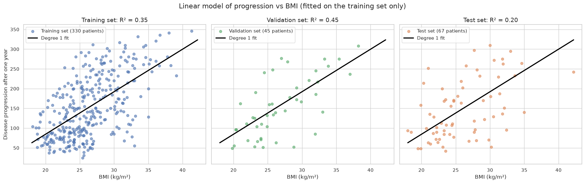
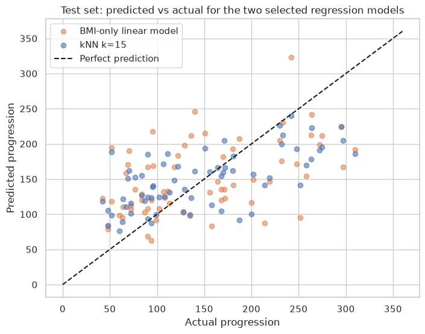
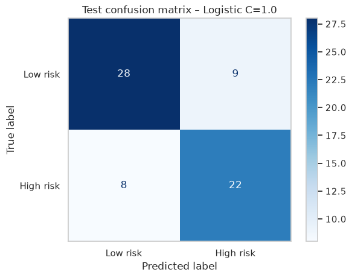

# Predicting Diabetes Progression – Practical Lab 2

**CSCN8010 – Foundations of Machine Learning Frameworks** · Prof. David Espinosa Carrillo
**Juan Antonio Sainz Gálvez** · Student ID 9072844

Screening model for **disease progression one year after baseline** (scikit-learn Diabetes dataset, 442 patients) comparing univariate and multivariate polynomial regression, decision trees, kNN and logistic regression with a 75/10/15 split and 5-fold cross-validation.

> **For reviewers:** the full report (code, answers to steps 1–14, conclusions) is in
> [`CSCN8010_PracticalLab2_DiabetesRegression.ipynb`](CSCN8010_PracticalLab2_DiabetesRegression.ipynb).
> Setup and run instructions are in [`documents/SETUP_AND_RUN.md`](documents/SETUP_AND_RUN.md) (one step: `setup_and_run.bat`).

## Key results (test set)

| Model | What it predicts | Test result |
|---|---|---|
| BMI only, degree 1 (Part 2) | progression = −130.87 + 10.77 × BMI | R² 0.20 · MAE 54.9 · MAPE 48.8 % |
| **kNN k=15, all features (Part 3)** | progression from the 15 most similar patients | **R² 0.41 · MAE 46.3 · MAPE 42.3 %** |
| Logistic regression C=1.0 (Part 3) | high risk (progression > 142) | accuracy 0.75 · recall 0.73 · ROC-AUC 0.82 |

A patient with **BMI 30** is expected to reach a progression of **192**.

## BMI explains part of the risk…

Degrees 2–5 do not beat a straight line (all ≈ 0.45 validation R²), so the simplest model was chosen.

## …all features explain more

kNN k=15 was selected because it ranked first in 5-fold cross-validation; the polynomial models overfit (degree 3: validation R² −83) and can predict impossible negative values.

## Screening view: who is high risk?

8 of 30 high-risk test patients are missed; lowering the decision threshold would raise recall for screening.

## Limitations
Small dataset (442 patients) so metrics vary between splits · association, not causation · all models underestimate the highest-progression patients · the high-risk cut-off is statistical, not clinical.

---
Data: [scikit-learn Diabetes dataset](https://scikit-learn.org/stable/datasets/toy_dataset.html#diabetes-dataset) (Efron et al., 2004, *Least Angle Regression*).
