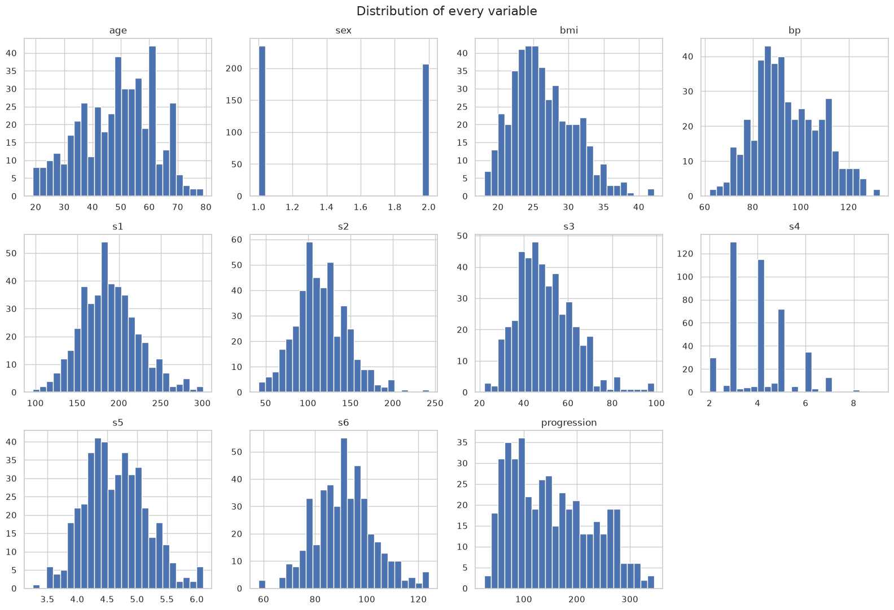
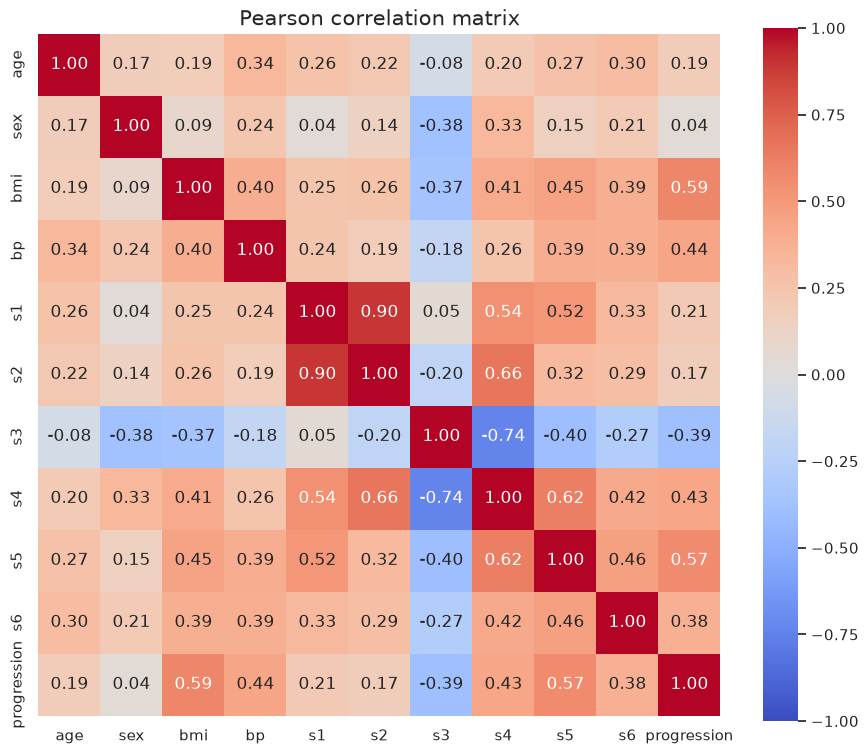
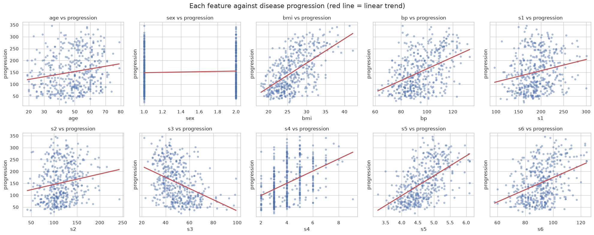
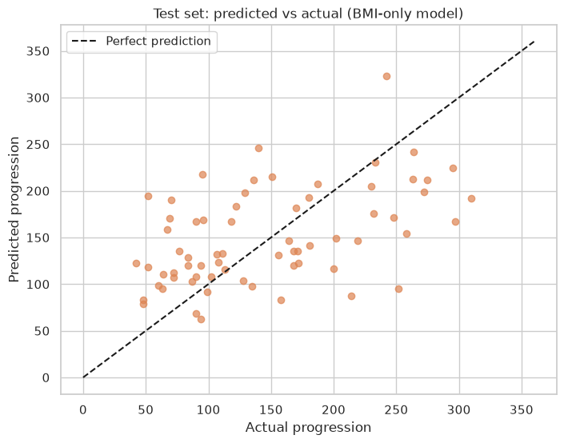

# Practical Lab 2 – Multivariate Linear Regression, Non-Parametric Models and Cross-Validation

**Course:** CSCN8010 – Foundations of Machine Learning Frameworks · **Professor:** David Espinosa Carrillo
**Student:** Juan Antonio Sainz Gálvez · **Student ID:** 9072844

Predicting diabetes disease progression one year after baseline (scikit-learn Diabetes dataset) with univariate and multivariate polynomial regression, decision trees, kNN and logistic regression, using a 75/10/15 train/validation/test split and 5-fold cross-validation.

---

## 1. Get the project and run it

### Prerequisites
- Windows 10/11 with PowerShell (tested), Python **3.11 or newer** on PATH, Git.
- VS Code with the **Python** and **Jupyter** extensions (only needed to open the notebook interactively).
- Internet access for `pip install`. The dataset ships with scikit-learn, so no data download is needed.

### Clone

```powershell
git clone https://github.com/antoniosg2025-stack/CSCN8010_PracticalLab2_DiabetesRegression.git
cd CSCN8010_PracticalLab2_DiabetesRegression
```

### One command: set up and run

```powershell
powershell -ExecutionPolicy Bypass -File .\setup_and_run.ps1
```

The script stops with a clear `ERROR:` message if any step fails. It:
1. checks that Python 3.11+ is available;
2. creates the virtual environment `.venv` inside the project;
3. installs the pinned packages from `requirements.txt`;
4. prints every package with its required and installed version and fails if any is missing or different, then runs `pip check`;
5. registers the kernel **"Python (CSCN8010 Lab 2)"** for VS Code/Jupyter;
6. executes the whole notebook from a fresh kernel.

**Success criterion:** the last line printed is
`SUCCESS: environment ready and notebook executed without errors.`

### Manual alternative (same result)

```powershell
python -m venv .venv
.\.venv\Scripts\python.exe -m pip install -r requirements.txt
.\.venv\Scripts\python.exe -m pip check
.\.venv\Scripts\python.exe -m jupyter nbconvert --to notebook --execute --inplace CSCN8010_PracticalLab2_DiabetesRegression.ipynb
```

### Open in VS Code
Open the folder, open `CSCN8010_PracticalLab2_DiabetesRegression.ipynb`, click **Select Kernel** and choose **Python (CSCN8010 Lab 2)** (or the `.venv` interpreter), then **Restart → Run All**.

### Expected outputs
- Part 2 selected model: Degree 1, equation `progression = -130.87 + 10.77 × BMI`, test R² ≈ 0.20, MAE ≈ 54.93, MAPE ≈ 48.75 %.
- Part 3 selected regression model: kNN k=15, test R² ≈ 0.41, MAE ≈ 46.28, MAPE ≈ 42.29 %.
- Logistic regression (C=1.0) on the test set: accuracy ≈ 0.75, recall ≈ 0.73, ROC-AUC ≈ 0.82.

### Project structure

```text
.
├── CSCN8010_PracticalLab2_DiabetesRegression.ipynb   # Full report: code, results, answers
├── images/                                          # Figures exported from the executed notebook
├── requirements.txt                                 # Pinned dependencies
├── setup_and_run.ps1                                # Environment setup + verification + execution
├── .gitignore
└── README.md
```

### Troubleshooting
- *"running scripts is disabled on this system"* → use the exact command above (it includes `-ExecutionPolicy Bypass` for this run only; no system setting is changed).
- *Kernel not listed in VS Code* → run step 5 of the script again or choose the interpreter `.venv\Scripts\python.exe`, then reload the VS Code window.

---

## 2. What was done

### Part 1 – Data, framing, EDA, cleaning, split
- Data loaded with `datasets.load_diabetes(as_frame=True, scaled=False)` so that features keep clinical units (BMI in kg/m²); scaling is applied inside model pipelines and fitted on training data only.
- Framed as regression (continuous target) for a screening tool; logistic regression uses a high-risk class (progression > training median, 142).
- EDA: statistics, histograms, scatter plots and correlation matrix. Strongest predictors: `bmi` (r = 0.59) and `s5` (0.57); strong multicollinearity between `s1`–`s2` (0.90) and `s3`–`s4` (−0.74).
- Cleaning: no missing values, no duplicates; IQR outliers are plausible clinical values and were kept.
- Split: 330 / 45 / 67 patients (75 % / 10 % / 15 %), `random_state=42`.

| | |
|---|---|
|  |  |



### Part 2 – Univariate polynomial regression on BMI (degrees 0–5)

| Model | Val R² | Val MAE | Val MAPE (%) | 5-fold CV R² |
|---|---|---|---|---|
| Degree 0 | -0.000 | 63.45 | 58.79 | -0.022 |
| **Degree 1** | **0.449** | **42.00** | **40.45** | **0.344** |
| Degree 2 | 0.449 | 41.76 | 40.31 | 0.341 |
| Degree 3 | 0.448 | 41.77 | 40.29 | 0.341 |
| Degree 4 | 0.448 | 41.74 | 40.28 | 0.341 |
| Degree 5 | 0.449 | 41.80 | 40.32 | 0.342 |

Degrees 1–5 are practically tied, so the simplest model (degree 1) is selected; it also has the best cross-validated R².

- **Equation:** progression = −130.87 + 10.77 × BMI
- **Test:** R² 0.204, MAE 54.93, MAPE 48.75 %
- **Prediction for BMI = 30:** 192.17
- **Trainable parameters:** degree *d* → *d* + 1 (intercept + one coefficient per power of BMI).




### Part 3 – Multivariate models (all 10 features)

| Model | Val R² | Val MAE | 5-fold CV R² | Test R² | Test MAE | Learned parameters |
|---|---|---|---|---|---|---|
| Polynomial degree 2 | 0.603 | 37.75 | 0.277 | 0.337 | 45.87 | 66 |
| Polynomial degree 3 | −82.520 | 273.02 | −67.186 | −35.669 | 234.11 | 286 |
| Decision tree depth 3 | 0.413 | 42.08 | 0.314 | 0.308 | 50.37 | 22 |
| Decision tree depth 6 | 0.163 | 51.21 | 0.184 | 0.088 | 54.09 | 172 |
| kNN k=5 | 0.426 | 45.53 | 0.343 | 0.391 | 45.38 | 0 (stores data) |
| **kNN k=15** | 0.553 | 40.19 | **0.421** | **0.411** | 46.28 | 0 (stores data) |

Selection rule: validation table first; when validation (45 patients) and 5-fold cross-validation (375 patients) disagree, cross-validation decides. **kNN k=15** is selected (test columns shown only after selection). Polynomial degree 3 and the depth-6 tree overfit; polynomial degree 2 is unstable and predicts an impossible negative value for an ordinary patient.

**Logistic regression** (high risk = progression > 142):

| Model | Val F1 | CV F1 | Test accuracy | Test recall | Test ROC-AUC |
|---|---|---|---|---|---|
| **C = 1.0** | 0.826 | **0.723** | 0.746 | 0.733 | 0.824 |
| C = 0.01 | 0.844 | 0.706 | – | – | – |


### Conclusions and limitations
- BMI alone explains a limited share of progression; all features together improve every metric (test MAE ≈ 46 vs ≈ 55).
- All regression models pull predictions toward the mean and **underestimate the highest-risk patients** – the costly false negatives of a screening tool. The logistic model misses 8 of 30 high-risk test patients; lowering its threshold would raise recall.
- Small dataset (442 patients) → metrics vary strongly between splits; association, not causation; the high-risk threshold is statistical, not clinical.
- Talking points from the Performance Metrics, kNN and Logistic Regression workshops are discussed in the notebook.

## 3. Sources
- scikit-learn Diabetes dataset: https://scikit-learn.org/stable/datasets/toy_dataset.html#diabetes-dataset
- Efron, B., Hastie, T., Johnstone, I. & Tibshirani, R. (2004). *Least Angle Regression*. Annals of Statistics, 32(2), 407–499.
